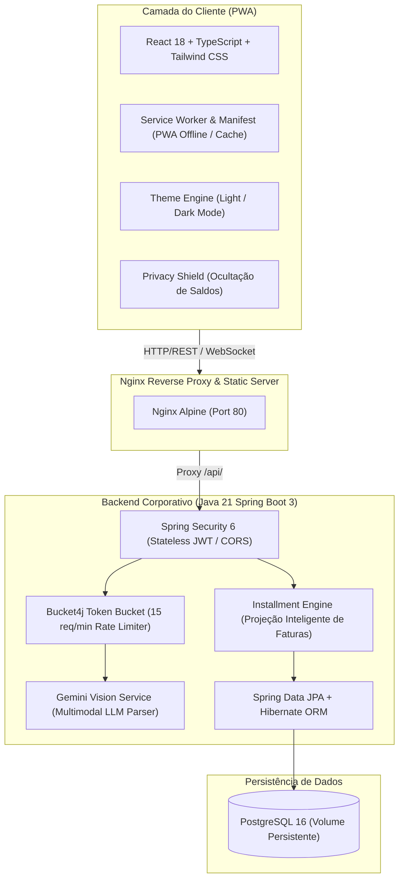
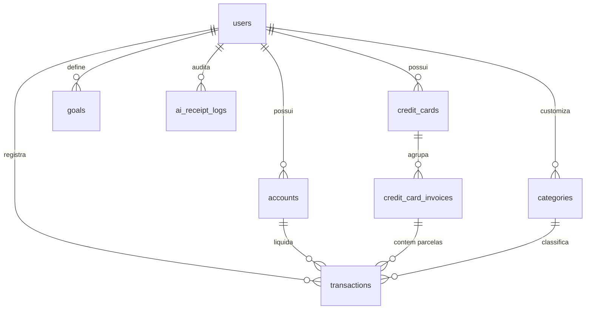

# 🪙 Finanças Pro — Plataforma Inteligente de Gestão Financeira PWA

[](https://openjdk.org/)
[](https://spring.io/projects/spring-boot)
[](https://react.dev/)
[](https://www.typescriptlang.org/)
[](https://tailwindcss.com/)
[](https://www.postgresql.org/)
[](https://www.docker.com/)
[](https://ai.google.dev/)
[](https://tailwindcss.com/)
[](https://web.dev/progressive-web-apps/)
[](https://git-scm.com/)

Finanças Pro é uma aplicação moderna de gestão financeira pessoal e familiar construída sob os princípios da engenharia de software corporativa, arquitetura limpa (Clean Architecture / 12-Factor App) e experiência de usuário inspirada nas fintechs mais avançadas do mundo (Nubank, Revolut, Copilot Money).

O ecossistema é composto por um **Frontend PWA (Progressive Web App)** totalmente responsivo e instalável (Mobile & Desktop), um **Backend robusto em Java 21 + Spring Boot 3 + Lombok**, e um **mecanismo de visão computacional multimodal com Google Gemini** capaz de ler cupons fiscais, notas e comprovantes Pix com controle inteligente de taxa de requisições (*Rate Limiting*).

---

## 🏛️ Visão Geral da Arquitetura



---

## 🚀 Principais Diferenciais e Recursos de Engenharia

### 1. 🤖 Leitor de Comprovantes com IA & Rate Limiting Preditivo
- **Ingestão Multimodal**: Captura fotos da câmera do smartphone ou aceita upload de arquivos (JPEG, PNG, WebP e PDF) no desktop.
- **Extração Semântica Estruturada**: O modelo **Gemini 1.5 Flash Vision** extrai com precisão cirúrgica: estabelecimento, valor total, data da transação, categoria predita e método de liquidação sugerido.
- **Rate Limiting com Bucket4j**: O backend gerencia rigorosamente a janela deslizante de **15 requisições por minuto** do tier gratuito da API.
- **Feedback Reativo no PWA**: Caso o limite temporário seja atingido, a API retorna `HTTP 429 Too Many Requests` com o tempo exato de reset. O frontend aciona automaticamente um cronômetro regressivo na UI e dispara uma notificação de sucesso assim que o envio é liberado.

### 2. 💳 Motor de Parcelamento Inteligente & Faturas Futuras
- Ao cadastrar uma compra parcelada no cartão de crédito (ex: 10x de R$ 399,90):
  - O backend calcula as datas de corte e vencimento de cada ciclo.
  - Distribui as parcelas proporcionalmente com ajuste de centavos residuais na primeira cota.
  - Aloca cada lançamento na respectiva fatura (`Invoice`) de cada mês futuro (criando as faturas futuras sob demanda).
  - Permite a visualização preditiva do fluxo de caixa e comprometimento de limite dos próximos meses.

### 3. 📱 Experiência PWA Híbrida (Mobile-First + Desktop-Optimized)
- **Instalável Nativo**: Funciona como aplicativo nativo no Android, iOS, Windows e macOS sem depender de app stores.
- **Navegação Ergonômica**: Barra inferior com atalhos de polegar e botão flutuante de câmera no mobile; sidebar expansível e tabelas ricas no PC.
- **Modo Privacidade**: Alternador no cabeçalho que mascara instantaneamente todos os valores monetários (`••••••`) para uso seguro em locais públicos.
- **Temas Claro e Escuro**: Suporte completo a Modo Escuro refinado e Modo Claro (*clean white*), com persistência no `localStorage`.

---

## 🗄️ Modelo de Entidades e Relacionamentos (ERD)



---

## 🛠️ Stack Tecnológica Detalhada

### Backend
| Componente | Tecnologia | Finalidade |
| :--- | :--- | :--- |
| Linguagem | **Java 21 LTS** | Runtime moderno com Virtual Threads e Records |
| Framework | **Spring Boot 3.3.4** | Arquitetura RESTful corporativa de alta performance |
| Produtividade | **Project Lombok** | Redução drástica de boilerplate (`@Getter`, `@Setter`, `@Builder`) |
| Persistência | **Spring Data JPA / Hibernate** | Mapeamento ORM e auto-geração de DDL no PostgreSQL |
| Rate Limiting | **Bucket4j Core 8.10** | Algoritmo Token Bucket para controle de cota de IA |
| Segurança | **Spring Security 6 + JJWT** | Autenticação stateless e controle de CORS |
| Inteligência Artificial | **Google Gemini API** | Extração multimodal de dados fiscais |
| Build Tool | **Apache Maven 3.9** | Gerenciamento de ciclo de vida e dependências |

### Frontend
| Componente | Tecnologia | Finalidade |
| :--- | :--- | :--- |
| Biblioteca UI | **React 18** | Renderização reativa baseada em componentes funcionais |
| Tipagem | **TypeScript 5.6** | Tipagem estática rigorosa para contratos de API |
| Bundler | **Vite 5** | Hot Module Replacement (HMR) e bundling otimizado |
| Estilização | **Tailwind CSS 3.4** | Design responsivo com suporte a dark/light mode nativo |
| PWA Engine | **Vite Plugin PWA + Workbox** | Service Worker, manifesto e suporte offline |
| Ícones | **Lucide React** | Biblioteca iconográfica moderna e minimalista |
| Visualização de Dados | **Recharts** | Gráficos responsivos de rosca e fluxo financeiro |

---

## 📂 Estrutura Modular do Projeto

```
financas-pro/
├── docker-compose.yml              # Orquestração do PostgreSQL, Backend e Frontend
├── .env.example                    # Template de variáveis de ambiente
├── .gitignore                      # Proteção de credenciais e binários
│
├── backend/                        # API Spring Boot 3
│   ├── Dockerfile                  # Build multi-stage Java 21 Alpine
│   ├── pom.xml                     # Dependências do projeto
│   └── src/main/java/com/financas/app/
│       ├── config/                 # Security, CORS e RateLimiter
│       ├── domain/                 # Entidades JPA (User, Account, CreditCard, Transaction, etc.)
│       ├── dto/                    # Java Records para Request/Response
│       ├── repository/             # Spring Data JPA Repositories
│       ├── service/                # Regras de negócio (Installment, Gemini, RateLimit)
│       └── controller/             # Endpoints REST
│
└── frontend/                       # Aplicação PWA
    ├── Dockerfile                  # Build multi-stage Node 20 + Nginx Alpine
    ├── nginx.conf                  # Configuração de proxy reverso e SPA routing
    ├── package.json
    ├── vite.config.ts              # Configuração do Vite e PWA Service Worker
    └── src/
        ├── components/             # Componentes modulares (Dashboard, Cards, Scanner, Modals)
        ├── services/               # Camada de comunicação com a API
        └── types.ts                # Definições de tipos TypeScript
```

---

## 🚀 Como Executar o Projeto

### Pré-requisitos
- **Docker & Docker Compose** (ou Java 21, Maven e Node.js para rodar localmente).

---

### Opção 1: Inicialização Completa com Docker Compose (Recomendada)

1. Clone o repositório:
```bash
git clone https://github.com/Arione-Dev/Financas-pro.git
cd Financas-pro
```

2. Crie o arquivo `.env` a partir do template:
```bash
cp .env.example .env
```
*Edite o arquivo `.env` e configure sua `GEMINI_API_KEY` do Google AI Studio.*

3. Inicie os containers:
```bash
docker compose up -d --build
```

4. Acesse:
- **Aplicação Web / PWA**: `http://localhost` (ou o IP do seu servidor na rede local)
- **API Backend**: `http://localhost:8080/api/dashboard/summary`
- **Console H2 (em modo dev se habilitado)**: `http://localhost:8080/h2-console`

---

### Opção 2: Execução Local em Modo Desenvolvimento

#### Frontend:
```bash
cd frontend
npm install
npm run dev
```
Disponível em: `http://localhost:5173`

#### Backend:
```bash
cd backend
mvn spring-boot:run
# ou execute: java -jar target/financas-api-0.0.1-SNAPSHOT.jar
```
Disponível em: `http://localhost:8080`

---

## 🌿 Metodologia Gitflow & Padrão de Versionamento

O projeto adota rigorosamente as práticas do **Gitflow** adaptado com convenções em Português do Brasil:

- `main`: Branch de produção, contendo apenas versões testadas, estáveis e prontas para deploy no servidor.
- `funcionalidade/*` ou `melhoria/*`: Branches criadas a partir de `main` para o desenvolvimento de novas features ou aprimoramentos de interface.
- `correcao/*`: Branches dedicadas à resolução de inconsistências ou bugs encontrados.
- **Padrão de Mensagens de Commit (Conventional Commits)**:
  - `feat`: Adição de nova funcionalidade (ex: `feat: adiciona leitor de comprovantes`).
  - `fix` ou `seguranca`: Correção de erro ou ajuste de segurança.
  - `melhoria`: Refinamento de usabilidade, contraste ou performance.
  - `docs`: Atualizações na documentação ou arquitetura.

---

## 🔒 Segurança & Boas Práticas (12-Factor App)

- **Proteção de Segredos**: Credenciais de banco de dados, chaves de API do Google e segredos de token JWT são consumidos estritamente via variáveis de ambiente (`.env`).
- **Sanitização no Git**: O arquivo `.gitignore` isola estritamente qualquer arquivo de configuração local contendo senhas reais.
- **Persistência de Dados**: O banco de dados PostgreSQL roda acoplado a volumes Docker persistentes (`postgres_data`), garantindo integridade dos registros mesmo em reinicializações do servidor.

---

## 📄 Licença

Distribuído sob a licença MIT. Consulte `LICENSE` para mais informações.
